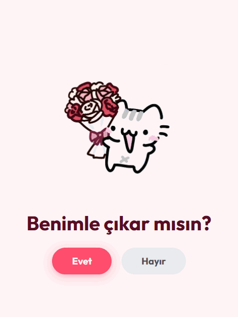

# Will You Go Out With Me?

  
  
  

<a href="#-english"><b>🇬🇧 English</b></a> · <a href="#-türkçe"><b>🇹🇷 Türkçe</b></a>

 

<table align="center">
  <tr>
    <td align="center" width="25%"> <b>Proposal</b> one question</td>
    <td align="center" width="25%"> <b>Runaway No</b> it dodges</td>
    <td align="center" width="25%"> <b>Music</b> fades in</td>
    <td align="center" width="25%"> <b>No install</b> open in a browser</td>
  </tr>
</table>

##  Demo

   Clicking No four times, then Yes

---

## 🇬🇧 English

###  About the Project
An interactive proposal page made to give someone you like a sweet surprise. 🥰 It asks *"Will you go out with me?"* — every click on "No" makes it jump away while the "Yes" button keeps growing, so there is really only one answer. Soft background music fades in as well.

###  Tech Stack
- **HTML5** (structure)
- **CSS3** (design and animations)
- **JavaScript** (the mischievous button movement and logic)

###  Usage
Open `do_you_love_me/index.html` in any browser. No installation needed.

---

## 🇹🇷 Türkçe

###  Proje Hakkında
Sevdiklerinize tatlı bir sürpriz yapmanız için hazırlanan interaktif bir teklif sayfası. 🥰 Sayfa *"Benimle çıkar mısın?"* diye sorar; "Hayır"a her tıklandığında buton kaçar, "Evet" butonu ise büyür; yani aslında tek bir cevap vardır. Arka planda yavaşça yükselen bir müzik de çalar.

###  Kullanılan Teknolojiler
- **HTML5** (yapı)
- **CSS3** (tasarım ve animasyonlar)
- **JavaScript** (muzip buton hareketleri ve mantık)

###  Kullanım
`do_you_love_me/index.html` dosyasını herhangi bir tarayıcıda açın. Kurulum gerekmez.

 

  
  Made by <a href="https://github.com/huseyinbaranisik">Hüseyin Baran Işık</a> · Animated emojis: <a href="https://github.com/Tarikul-Islam-Anik/Animated-Fluent-Emojis">Animated Fluent Emojis</a>

