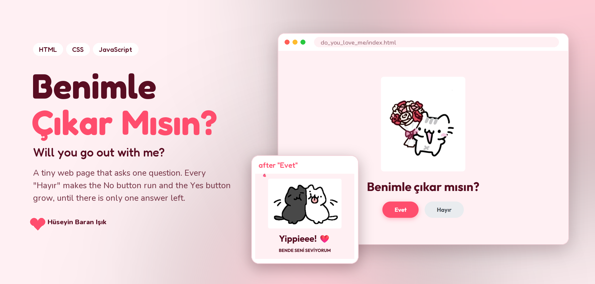
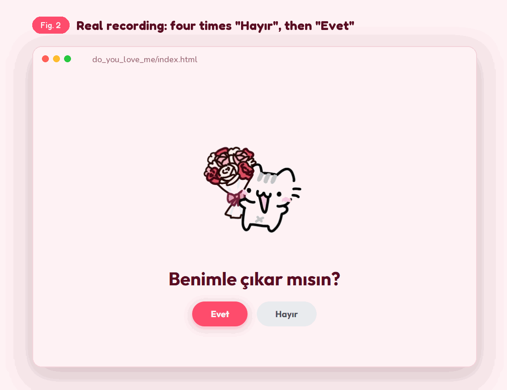
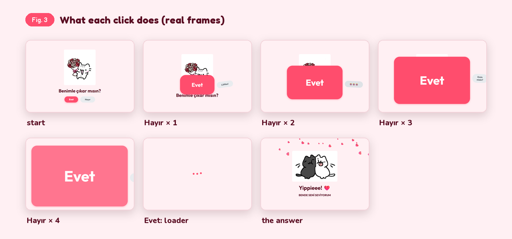
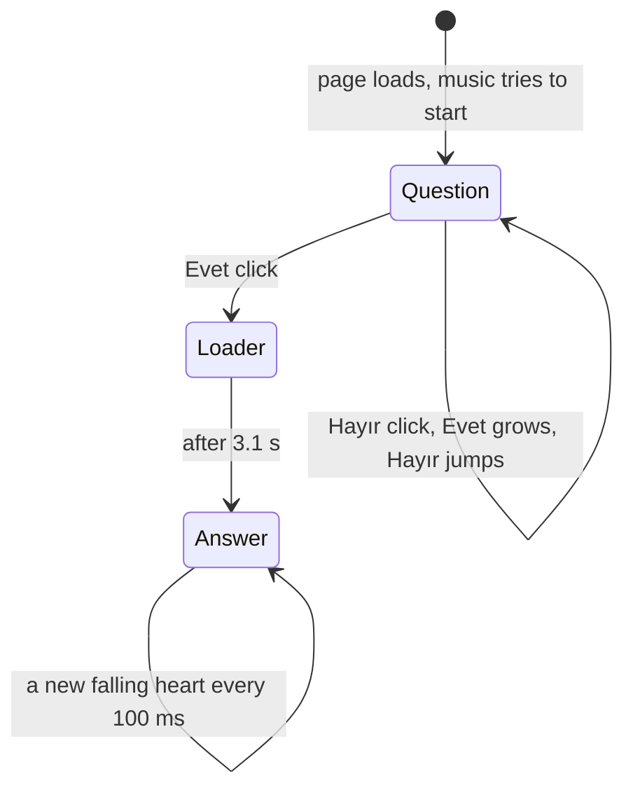
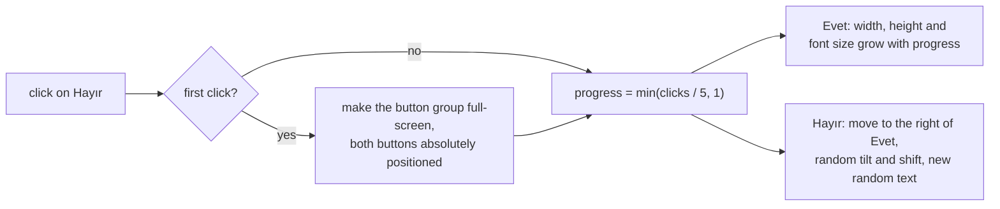

<p align="center">
  
</p>

<p align="center">
  <a href="https://huseyinbaranisik.github.io/do_you_love_me/"><b>Open the live page</b></a> &nbsp;·&nbsp;
  <a href="#demo">Demo</a> &nbsp;·&nbsp;
  <a href="#what-it-does">What it does</a> &nbsp;·&nbsp;
  <a href="#how-it-works">How it works</a> &nbsp;·&nbsp;
  <a href="#run-it">Run it</a> &nbsp;·&nbsp;
  <a href="#known-limits">Limits</a> &nbsp;·&nbsp;
  <a href="#türkçe">Türkçe</a>
</p>

**Benimle Çıkar Mısın?** (*Will you go out with me?*) is a one-page website for asking someone out. It asks one
question with two buttons. "Hayır" (No) does not really work: every click makes it jump away and makes "Evet"
(Yes) bigger, until Yes fills the screen. Pressing Yes plays a short heart animation and shows the answer.
It is plain HTML, CSS and JavaScript, with no build step and no libraries.

**Live:** <https://huseyinbaranisik.github.io/do_you_love_me/>

<br>

## Demo

<p align="center">
  
</p>

This is a real recording of `do_you_love_me/index.html` in Chromium, made with Playwright: four clicks on
"Hayır", then one on "Evet". The page has background music, which a GIF cannot show.

<p align="center">
  
</p>

<br>

## What it does

<table>
<tr><td width="26%"><b>One question</b></td><td>A cat with flowers, "Benimle çıkar mısın?" and two buttons: <b>Evet</b> (pink) and <b>Hayır</b> (grey).</td></tr>
<tr><td><b>The runaway No</b></td><td>Each click on Hayır moves it next to the growing Yes button, tilts it a little (up to 10°), shifts it up or down (up to 20 px) and changes its text to one of "Emin misin?", "Lütfen!", "LÜTFEEEEN!!", "😭😭😭" or "🤨🤨🤨".</td></tr>
<tr><td><b>The growing Yes</b></td><td>After <i>n</i> clicks (up to 5), Evet is <code>n/5 × 95vw + 120px</code> wide, <code>n/5 × 95vh + 50px</code> tall, with text from 1.2 rem up to 10 rem. After five clicks it covers the screen and pushes No off the edge.</td></tr>
<tr><td><b>The answer</b></td><td>Evet starts a 3.1-second loader (three dots that merge, then a heart). Then two cuddling cats, "Yippieee! ❤️" and "BENDE SENİ SEVİYORUM", with hearts falling from the top every 100 ms.</td></tr>
<tr><td><b>Music</b></td><td><code>assets/I_wanna_bu_yours.mp3</code> loops in the background. It starts at 30 % volume and rises to 100 % over 5 seconds. If the browser blocks autoplay, it starts on the first click anywhere.</td></tr>
</table>

<br>

## How it works

Everything lives in three files: `index.html` (the question and buttons), `style.css` (colours, buttons, the
loader and the falling-heart animation) and `script.js` (all behaviour). The page states:



What one click on Hayır does in `script.js`:



The colours are the CSS variables in `style.css`: `--primary #ff4d6d`, `--secondary #ff758f`, `--dark #590d22`,
`--light #fff0f3`, and a `#ffb3c1 → #ff8fa3` gradient. The page font is Outfit from Google Fonts.

<br>

## Run it

The easiest way is the live page: <https://huseyinbaranisik.github.io/do_you_love_me/>. It is published from the
`do_you_love_me/` folder by [`.github/workflows/pages.yml`](.github/workflows/pages.yml) on every push to `main`.

To run it locally there is nothing to install. Open `do_you_love_me/index.html` in a browser, or serve the folder,
which some browsers prefer for audio:

```bash
cd do_you_love_me
python -m http.server 8000
```

Then open `http://localhost:8000`.

<br>

## Known limits

- **Turkish only.** All texts on the page are Turkish.
- **The music is a commercial song.** `I_wanna_bu_yours.mp3` is in the public repository; make sure you have the
  right to share it.
- **No way back.** After the answer screen there is no reset; reload the page to start over.

<br>

## Credits

- Page by Hüseyin Baran Işık.
- README figures set in Fredoka and Nunito, both under the SIL Open Font License ([`tools/fonts/`](tools/fonts/)),
  in the page's own colours. Rendered by [`tools/render_figures.py`](tools/render_figures.py) from Playwright
  recordings of the page.

<br>

---

## Türkçe

**Benimle Çıkar Mısın?**, birine çıkma teklif etmek için hazırlanmış tek sayfalık bir web sitesidir. İki butonlu tek
bir soru sorar. "Hayır" aslında işe yaramaz: her tıklamada kaçar ve "Evet"i büyütür, sonunda Evet bütün ekranı
kaplar. Evet'e basınca kısa bir kalp animasyonu oynar ve cevap ekranı gelir. Düz HTML, CSS ve JavaScript ile
yazılmıştır; derleme adımı ya da kütüphane yoktur.

**Canlı:** <https://huseyinbaranisik.github.io/do_you_love_me/>

### Demo

Yukarıdaki GIF (Şekil 2), `do_you_love_me/index.html`'in Chromium'da Playwright ile alınmış gerçek bir kaydıdır:
dört kez "Hayır", sonra bir kez "Evet". Sayfada arka plan müziği var; GIF bunu gösteremez. Şekil 3, her tıklamadan
sonraki gerçek kareleri yan yana gösterir.

### Ne yapıyor

<table>
<tr><td width="26%"><b>Tek soru</b></td><td>Çiçekli bir kedi, "Benimle çıkar mısın?" ve iki buton: <b>Evet</b> (pembe) ve <b>Hayır</b> (gri).</td></tr>
<tr><td><b>Kaçan Hayır</b></td><td>Hayır'a her tıklamada buton büyüyen Evet'in yanına kayar, biraz eğilir (en fazla 10°), yukarı ya da aşağı oynar (en fazla 20 px) ve yazısı "Emin misin?", "Lütfen!", "LÜTFEEEEN!!", "😭😭😭" ya da "🤨🤨🤨" olur.</td></tr>
<tr><td><b>Büyüyen Evet</b></td><td><i>n</i> tıklamadan sonra (en fazla 5) Evet <code>n/5 × 95vw + 120px</code> genişliğinde, <code>n/5 × 95vh + 50px</code> yüksekliğindedir; yazısı 1.2 rem'den 10 rem'e büyür. Beş tıklamadan sonra ekranı kaplar ve Hayır'ı kenardan dışarı iter.</td></tr>
<tr><td><b>Cevap</b></td><td>Evet, 3.1 saniyelik bir yükleme animasyonu başlatır (birleşen üç nokta, sonra bir kalp). Ardından sarılan iki kedi, "Yippieee! ❤️" ve "BENDE SENİ SEVİYORUM" yazısı; yukarıdan her 100 ms'de bir kalp düşer.</td></tr>
<tr><td><b>Müzik</b></td><td><code>assets/I_wanna_bu_yours.mp3</code> arka planda döngüyle çalar. %30 sesle başlar ve 5 saniyede %100'e çıkar. Tarayıcı otomatik oynatmayı engellerse, sayfada herhangi bir yere ilk tıklamada başlar.</td></tr>
</table>

### Nasıl çalışıyor

Her şey üç dosyada: `index.html` (soru ve butonlar), `style.css` (renkler, butonlar, yükleme ve düşen kalp
animasyonu) ve `script.js` (bütün davranış). Sayfanın durumları ve Hayır'a bir tıklamanın ne yaptığı yukarıdaki iki
Mermaid diyagramında gösteriliyor. Renkler `style.css` içindeki CSS değişkenleridir: `--primary #ff4d6d`,
`--secondary #ff758f`, `--dark #590d22`, `--light #fff0f3` ve `#ffb3c1 → #ff8fa3` geçişi. Sayfanın fontu Google
Fonts'tan Outfit.

### Çalıştırma

En kolayı canlı sayfa: <https://huseyinbaranisik.github.io/do_you_love_me/>. Sayfa, `main`'e her push'ta
[`.github/workflows/pages.yml`](.github/workflows/pages.yml) ile `do_you_love_me/` klasöründen yayınlanır.

Yerelde çalıştırmak için kurulum gerekmez. `do_you_love_me/index.html` dosyasını bir tarayıcıda aç ya da klasörü
bir sunucuyla aç; bazı tarayıcılar ses için bunu tercih eder:

```bash
cd do_you_love_me
python -m http.server 8000
```

Sonra `http://localhost:8000` adresini aç.

### Bilinen kısıtlar

- **Yalnızca Türkçe.** Sayfadaki bütün yazılar Türkçe.
- **Müzik ticari bir şarkı.** `I_wanna_bu_yours.mp3` herkese açık repoda duruyor; paylaşma hakkın olduğundan emin ol.
- **Geri dönüş yok.** Cevap ekranından sonra sıfırlama yok; baştan başlamak için sayfayı yenile.

### Teşekkür

- Sayfa: Hüseyin Baran Işık.
- README figürlerinde Fredoka ve Nunito kullanıldı; ikisi de SIL Open Font License altındadır
  ([`tools/fonts/`](tools/fonts/)). Renkler sayfanın kendi renkleri; figürler sayfanın Playwright kayıtlarından
  [`tools/render_figures.py`](tools/render_figures.py) ile üretildi.
